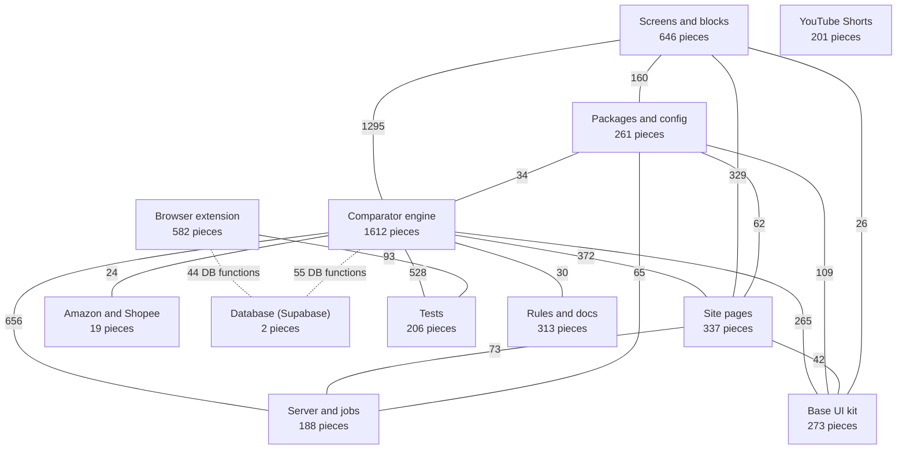

# Code map (melhorescolha.io)

Generated 24/11/2026 from commit `429f94a` by Graphify (tree-sitter, no AI).
Regenerate: `graphify update . && python3 ferramentas/mapa-do-codigo.py`.
Counts are code links (imports, calls, references), not site traffic.
Read this before changing code to see what lives where and what a change can break.

Solid line: code links between areas (20+ shown). Dotted: Supabase functions called by name.

## Areas

| Area | Paths | Pieces | Files | What it is | Most connected |
|---|---|---|---|---|---|
| Site pages | `src/routes/*.tsx, src/router.tsx` | 337 | 35 | Routes visitors open: home (index.tsx), categories, campaigns, guides, Meus preços, admin. | `routeTree.gen.ts`, `index.tsx`, `amigo-secreto.tsx` |
| Screens and blocks | `src/components/ (except ui/)` | 646 | 86 | Blocks that build the pages: link search, guided search, showcases, marketplace comparison. | `BuscaPorLink.tsx`, `BuscaGuiada.tsx`, `VitrineSazonal.tsx` |
| Base UI kit | `src/components/ui/` | 273 | 46 | shadcn primitives: buttons, menus, forms, carousels. | `sidebar.tsx`, `Button`, `menubar.tsx` |
| Comparator engine | `src/lib/, src/hooks/, src/content/, src/integrations/` | 1612 | 141 | Same-product check, search, recommendations, shipping, delivery date, visitor profile, affiliate links. Center of the system. | `cn()`, `busca-guiada.ts`, `busca-intencao.ts` |
| Amazon and Shopee | `src/lib/integracoes/` | 19 | 3 | On-demand search in the other stores. | `amazon.ts`, `shopee.ts`, `buscarNaAmazon()` |
| Server and jobs | `src/routes/api/, src/server.ts, src/lib/mcp/` | 188 | 40 | Public APIs and scheduled jobs: sourcing cron, Telegram webhook, operation, search. | `cron-garimpo.ts`, `telegram-webhook.ts`, `amigo-secreto-vitrine.ts` |
| Database (Supabase) | `supabase/, drizzle/` | 2 | 2 | Tables and functions in project itgdvxvqbwjcvmglfval. | `drizzle.config.ts`, `schema.ts` |
| Browser extension | `extensao/` | 582 | 20 | Generates Weslei's affiliate links and compares prices (background.js, comparador.js, sincronia.js). | `background.js`, `comparador.js`, `sincronia.js` |
| Tests | `tests/, extensao/testes/` | 206 | 94 | bun tests; a failure blocks push and merge. | `comparador.test.mjs`, `recomendacoes.test.ts`, `multiloja.test.mjs` |
| YouTube Shorts | `scripts/automacao_shorts/, ferramentas/video/` | 201 | 20 | Standalone Python pipeline: product radar, script, video edit, upload. | `gerador_roteiro.py`, `radar_produtos.py`, `Config` |
| Rules and docs | `CLAUDE.md, AGENTS.md, docs/` | 313 | 50 | Project rules, topic files, intelligence reports. | `vitrines-e-campanhas`, `visual-e-texto`, `Project rules (Weslei Mendes, melhorescolha.io)` |
| Packages and config | `package.json, tsconfig.json, public/, .lovable/, ferramentas/` | 261 | 14 | Dependencies, TypeScript, app manifest, extension check tools. | `react`, `lucide-react`, `@tanstack/react-router` |

## Strongest links between areas

- Screens and blocks ↔ Comparator engine: 1295
- Comparator engine ↔ Server and jobs: 656
- Comparator engine ↔ Tests: 528
- Comparator engine ↔ Site pages: 372
- Screens and blocks ↔ Site pages: 329
- Comparator engine ↔ Base UI kit: 265
- Screens and blocks ↔ Packages and config: 160
- Packages and config ↔ Base UI kit: 109

## Things the map makes clear

- The extension never imports site code. Extension and site talk only through Supabase functions (44 called by the extension, 55 by the site). Changing a function's signature breaks both sides: create a `_v2` instead (rule in CLAUDE.md).
- YouTube Shorts is standalone Python and shares no code with the site.
- Every buy path must still end in Weslei's affiliate link (rule no. 1); check the pieces below when touching links or buttons.

## Most connected pieces (widest impact when changed)

| # | Piece | File | Area | Links |
|---|---|---|---|---|
| 1 | `background.js` | `extensao/background.js` | Browser extension | 291 |
| 2 | `BuscaPorLink.tsx` | `src/components/BuscaPorLink.tsx` | Screens and blocks | 257 |
| 3 | `cn()` | `src/lib/utils.ts` | Comparator engine | 231 |
| 4 | `routeTree.gen.ts` | `src/routeTree.gen.ts` | Site pages | 215 |
| 5 | `react` | `package.json` | Packages and config | 145 |
| 6 | `BuscaGuiada.tsx` | `src/components/BuscaGuiada.tsx` | Screens and blocks | 121 |
| 7 | `index.tsx` | `src/routes/index.tsx` | Site pages | 117 |
| 8 | `lucide-react` | `package.json` | Packages and config | 98 |
| 9 | `busca-guiada.ts` | `src/lib/busca-guiada.ts` | Comparator engine | 97 |
| 10 | `@tanstack/react-router` | `package.json` | Packages and config | 94 |
| 11 | `VitrineSazonal.tsx` | `src/components/VitrineSazonal.tsx` | Screens and blocks | 93 |
| 12 | `package.json` | `package.json` | Packages and config | 84 |
